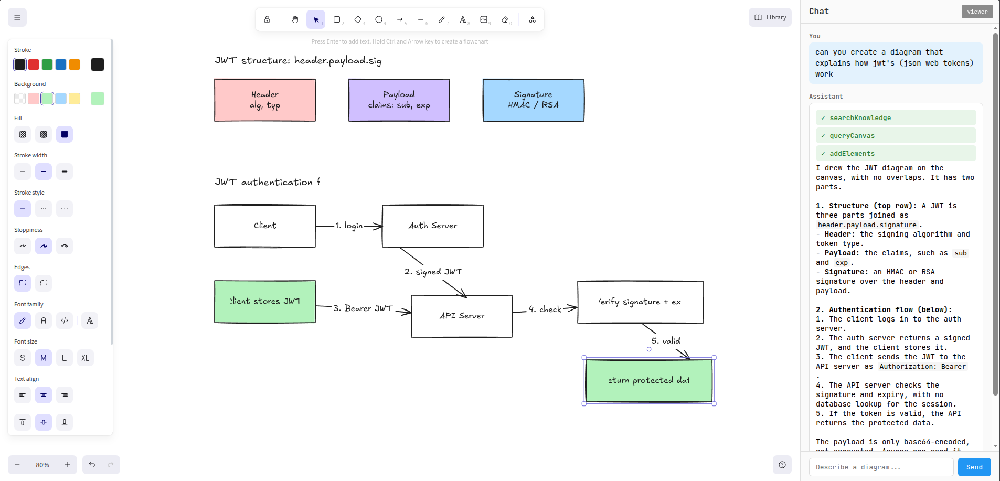
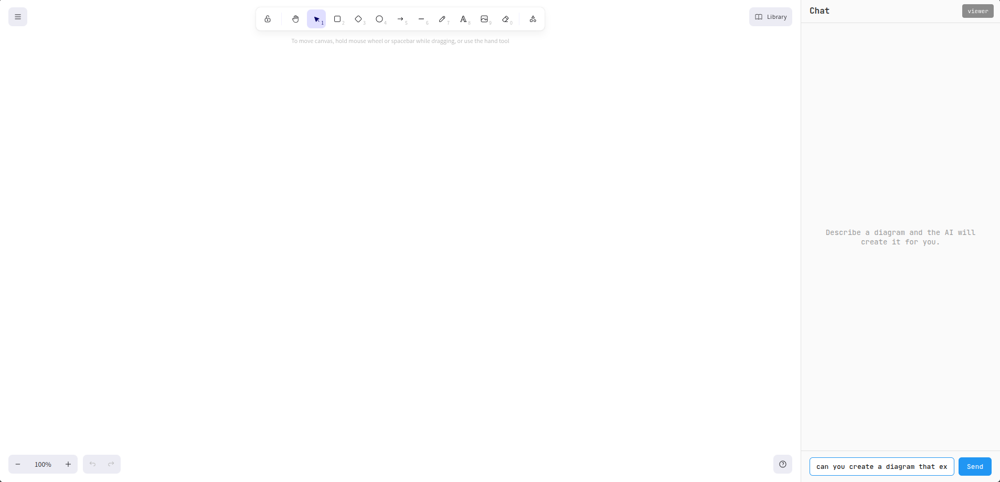
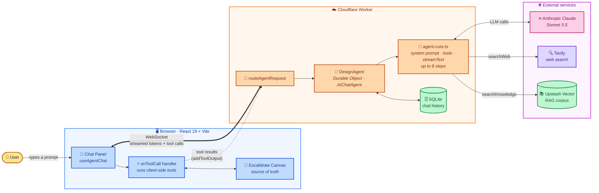
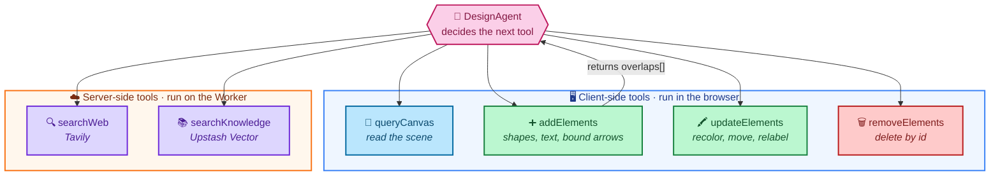
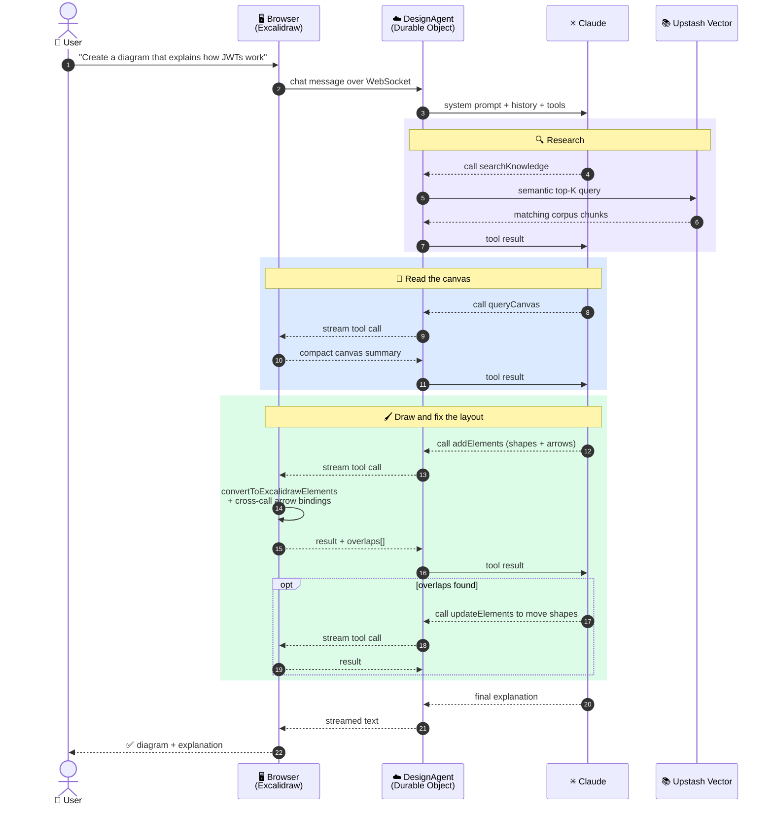
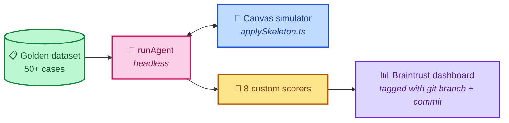

<div align="center">

# 🎨 DiagramForge AI

### Describe a system in plain English. Get a real, editable diagram.

**An agentic AI assistant that turns natural-language prompts into editable technical diagrams on a live Excalidraw canvas.**

<br/>


<br/>

*"Can you create a diagram that explains how JWTs work?"* ➜ a labeled, connected, overlap-free diagram you can keep editing **by hand or by chat**.

<br/>



</div>

---

## 📑 Table of contents

- [✨ What it does](#-what-it-does)
- [📸 Screenshots](#-screenshots)
- [🏗️ Architecture](#️-architecture)
- [🔄 How a request flows](#-how-a-request-flows)
- [🧰 Agent tools](#-agent-tools)
- [🧠 Key design decisions](#-key-design-decisions)
- [📊 Evaluation](#-evaluation)
- [📚 RAG knowledge base](#-rag-knowledge-base)
- [🚀 Getting started](#-getting-started)
- [🗂️ Project structure](#️-project-structure)

---

## ✨ What it does

DiagramForge AI is **not** a one-shot "prompt → picture" generator. It is a **multi-step, tool-using agent** that treats the canvas as state it can read, change and extend.

| | Capability | Example |
|---|---|---|
| 🖌️ | **Create** architecture, sequence, flowchart, state-machine and ER diagrams from plain English | *"Draw the OAuth authorization-code flow"* |
| ✏️ | **Modify** existing diagrams in conversation, without redrawing everything | *"Make the login box red"* · *"Add a cache between the API and the database"* |
| 🔎 | **Research before drawing** using a private RAG knowledge base and live web search, so diagrams of real systems are accurate | *"Diagram Kubernetes pod networking"* |
| 📐 | **Fix its own layouts**: every canvas change returns overlap feedback, and the agent must fix collisions in its next step | — |
| 🔗 | **Stay editable**: output is native Excalidraw shapes with real arrow bindings, so arrows follow when you drag a shape | — |

---

## 📸 Screenshots

<table>
<tr>
<td width="50%" valign="top">

**1. Start with a prompt**

An empty Excalidraw canvas on the left and the chat panel on the right. Describe the diagram you want and press **Send**.



</td>
<td width="50%" valign="top">

**2. The agent researches, reads the canvas and draws**

Each tool call shows up live in the chat (`searchKnowledge` → `queryCanvas` → `addElements`). The result is a normal Excalidraw scene you can keep editing.


</td>
</tr>
</table>

---

## 🏗️ Architecture

The app has three layers. The **browser** owns the canvas, the **Cloudflare Worker** runs the agent loop, and **external services** provide the model, research and evals.



<details>
<summary><b>🎨 Colour key</b></summary>

| Colour | Layer |
|---|---|
| 🟦 Blue | Browser: React UI and the Excalidraw canvas |
| 🟧 Orange | Cloudflare Worker and the `DesignAgent` Durable Object |
| 🟪 Pink | The LLM (Anthropic Claude) |
| 🟪 Purple | Live web search (Tavily) |
| 🟩 Green | Storage: SQLite chat history and the Upstash Vector knowledge base |

</details>

### Where each tool runs

Canvas tools run **in the browser**, because that is where the live scene is. Research tools run **on the Worker**, because they need API keys.



---

## 🔄 How a request flows

Here is what happens when you ask for a JWT diagram, as in the screenshot above.



---

## 🧰 Agent tools

| Tool | Runs on | Purpose |
|---|---|---|
| 👀 `queryCanvas` | 🖥️ Browser | Read a summary of every element on the canvas. Called before any change. |
| ➕ `addElements` | 🖥️ Browser | Add shapes, text and bound arrows using Excalidraw's skeleton format. Returns overlap detection. |
| 🖍️ `updateElements` | 🖥️ Browser | Recolor, move, relabel or resize existing elements by id. |
| 🗑️ `removeElements` | 🖥️ Browser | Delete elements by id. |
| 🔍 `searchWeb` | ☁️ Worker | Tavily search for current information about unfamiliar systems. |
| 📚 `searchKnowledge` | ☁️ Worker | Top-K semantic retrieval over a private corpus in Upstash Vector (RAG). |

All tool inputs are validated with **Zod** schemas (`src/tools/element-schema.ts`).

---

## 🧠 Key design decisions

| Concern | Approach |
|---|---|
| 🎯 **Canvas as source of truth** | The four canvas tools are *client-side* tools (no `execute` on the server). The Worker streams the call, the browser applies it to the live Excalidraw scene and returns the result via `addToolOutput`, and the agent loop resumes. |
| 💾 **Stateful sessions** | The agent runs as a Cloudflare **Durable Object** (`AIChatAgent`) that stores messages in SQLite for each session. |
| 🧩 **Shared agent core** | `src/agent-core.ts` holds the system prompt, tool wiring and step limit. The production Worker (`streamText`) and the eval harness (`generateText`) both call it, so they cannot drift apart. |
| 📐 **Layout feedback loop** | `addElements` returns an `overlaps` array from bounding-box collision detection (`src/context/overlaps.ts`). The system prompt makes fixing them mandatory. |
| 🔗 **Cross-call arrow binding** | Excalidraw's `convertToExcalidrawElements` only resolves arrow `start`/`end` ids within a single batch. `src/context/cross-call-bindings.ts` patches bindings to shapes from earlier calls or the existing canvas, so diagrams drawn over several calls don't end up with floating arrows. |
| 🗜️ **Compact canvas context** | `serializeCanvasState` gives the model a readable summary (id, type, position, label, connections) instead of raw Excalidraw JSON. |
| 💰 **Cost profile in one place** | `src/models.ts` sets the models: **Claude Sonnet 5.5** at `medium` effort for the live agent, **Claude Haiku 5.5** for evals, so a full eval run costs well under a dollar. |

---

## 📊 Evaluation

The agent is measured, not vibe-checked. `evals/` contains a **Braintrust** eval harness.



- **Golden dataset** (`evals/datasets/`): 50+ cases across `create` / `modify` / `domain` / `edge` categories, tagged by difficulty. Modify cases replay a made-up prior conversation, so the agent can't tell it apart from a real session.
- **Headless canvas simulator**: `runAgent` in `agent-core.ts` seeds an in-memory canvas and answers `queryCanvas` inline. `applySkeleton.ts` mirrors what Excalidraw would actually render, so scorers grade *rendered results*, not what the model claims it drew.
- **Custom scorers** (`evals/scorers/`):

  | Scorer | Checks that… |
  |---|---|
  | `schema` | tool inputs match the Zod element schema |
  | `structure` | the expected shapes and arrows exist |
  | `toolChoice` | the agent picked the right tools (e.g. `queryCanvas` before modifying) |
  | `labelKeyword` | key terms from the prompt appear as labels |
  | `boundArrows` | arrows are bound to shapes at both ends |
  | `boundLabels` | labels are bound to their containers |
  | `connectivity` | the diagram forms a connected graph |
  | `noOverlaps` | no shapes collide in the final layout |

- Every run is tagged with git branch, commit and dirty flag, so experiments are comparable in the Braintrust dashboard.

```bash
npm run eval
```

---

## 📚 RAG knowledge base

`data/corpus/` holds short reference docs the agent can consult before drawing:

| 📄 Document | Topic |
|---|---|
| `oauth-authorization-code-flow.md` | 🔐 OAuth 2.0 authorization-code flow |
| `kubernetes-pod-networking.md` | ☸️ Kubernetes pod networking |
| `postgres-write-path.md` | 🐘 PostgreSQL write path |
| `cloudflare-workers-request-lifecycle.md` | ☁️ Cloudflare Workers request lifecycle |
| `startup-org-structure.md` | 🏢 Startup org structure |
| `general-best-practices.md` | 📐 General diagramming best practices |

Upstash's hosted model creates the embeddings on the server. The embed script resets the index and re-adds every file, so it is safe to re-run:

```bash
npm run embed
```

---

## 🚀 Getting started

### Prerequisites

- **Node.js 20+**
- API keys:
  - 🟠 [Anthropic](https://platform.claude.com/): the Claude model
  - 🟢 [Upstash Vector](https://upstash.com/): create an index with a hosted embedding model
  - 🟣 [Tavily](https://tavily.com/): free tier is enough
  - ⚫ [Braintrust](https://www.braintrust.dev/): optional, only for evals

### Setup

```bash
git clone https://github.com/dhruv2223/diagramforge-ai
cd diagramforge-ai
npm install

cp .dev.vars.example .dev.vars
# fill in ANTHROPIC_API_KEY, TAVILY_API_KEY, BRAINTRUST_API_KEY,
# UPSTASH_VECTOR_REST_URL, UPSTASH_VECTOR_REST_TOKEN

npm run embed   # populate the knowledge base
npm run dev     # http://localhost:5173
```

Open **http://localhost:5173**, type a prompt into the chat panel, and watch the diagram appear.

### 💡 Prompts to try

```text
Draw the OAuth authorization-code flow
Create an architecture diagram for a URL shortener with a cache and a database
Explain how JWTs work with a diagram
Make the API Server box blue and add a load balancer in front of it
Draw a state machine for an order: pending, paid, shipped, delivered, cancelled
```

### Scripts

| Command | What it does |
|---|---|
| `npm run dev` | Vite dev server with the Cloudflare Worker running locally |
| `npm run build` | Production build |
| `npm run agent "draw a flowchart"` | Call the agent over WebSocket without the UI (dev server must be running) |
| `npm run eval` | Run the Braintrust eval suite |
| `npm run embed` | Rebuild the Upstash Vector index from `data/corpus/` |

### ☁️ Deploy

```bash
npx wrangler deploy
```

Set the same secrets in Cloudflare with `npx wrangler secret put <NAME>`.

---

## 🗂️ Project structure

```
src/
├── agent.ts              # DesignAgent Durable Object (AIChatAgent)
├── agent-core.ts         # System prompt, streamAgent (prod) + runAgent (eval)
├── models.ts             # Model choice + provider options (cost profile)
├── tools.ts              # Tool aggregator
├── tools/                # One file per tool + shared Zod element schema
├── context/
│   ├── canvas-state.ts   # Canvas → compact summary for the model
│   ├── overlaps.ts       # Bounding-box collision detection
│   ├── cross-call-bindings.ts
│   └── applySkeleton.ts  # Node-side simulator of Excalidraw's skeleton helper
├── rag/                  # Upstash Vector client + embed script
├── components/           # Canvas, chat panel, streaming + tool-status UI
└── worker.ts             # Worker entry
evals/
├── diagram.eval.ts       # Braintrust eval definition
├── datasets/             # Golden test cases
└── scorers/              # Custom scorers
data/corpus/              # RAG source documents
assets/                   # README screenshots
```
